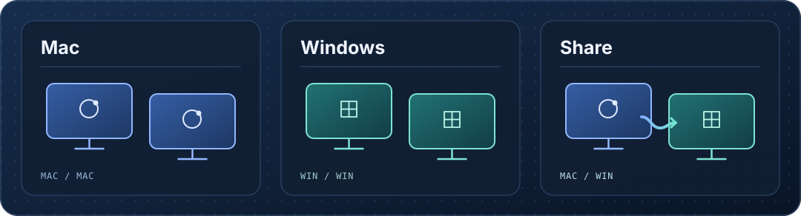

<p align="center">
  
</p>
<h1 align="center">TandOrbit</h1>
<p align="center"><strong>两台电脑、两块屏幕，一套键鼠。</strong></p>
<p align="center">
  <a href="https://github.com/signxer/TandOrbit/releases">已发布版本</a>
  · <a href="#从源码运行">从源码运行</a>
  · <a href="docs/使用说明.md">使用说明</a>
  · <a href="https://github.com/signxer/TandOrbit/actions/workflows/build.yml">构建与测试</a>
</p>

TandOrbit 让同一张桌上的 Mac 和 Windows 共用两台显示器。通过快捷键切换整套桌面，或让两台电脑各用一块屏幕，把鼠标推到边缘就能继续操作另一台。共享模式也支持双向同步新复制的文本。



## 开始使用

两台电脑都需要接到这两块显示器，并处在同一局域网。开启显示器的自动输入选择后，TandOrbit 通过调整两台电脑各自的显示输出，让显示器跟随活跃信号。

打开「设置 → 开始使用」，按顺序完成配对、屏幕绑定和连接检查。

1. **配对。** 两端运行同一版本，并打开「两台电脑 → 查找附近电脑」。在任一端选中另一台，核对两个窗口显示的同一个六位数字，然后在两边确认。
2. **绑定屏幕。** 在两端的「显示器」把同一块物理屏幕选作主屏，另一块选作副屏。默认共享时 Mac 用主屏、Windows 用副屏，可在 Mac 上修改。核对后保存设置。
3. **检查连接。** 回到「开始使用」点「开始检查」。确认连通并核对检测结果后，就可以回到主窗口试切。

可在「两台电脑」为设备自定义名称和图标。需要共用键鼠时，在两端「键鼠与剪贴板」中选择键鼠实际连接的那台电脑，再选择光标从哪条边跨过去。Mac 需授予 TandOrbit 辅助功能和输入监控权限。

| 操作 | macOS | Windows |
| --- | --- | --- |
| Mac 双屏 | `Control + Option + 1` | `Ctrl + Alt + 1` |
| Windows 双屏 | `Control + Option + 2` | `Ctrl + Alt + 2` |
| 两台电脑各用一屏 | `Control + Option + 3` | `Ctrl + Alt + 3` |
| 立即收回键鼠 | `Control + Option + Esc` | `Ctrl + Alt + Esc` |

两个系统都可从主窗口或托盘切换模式。文本剪贴板由两端分别启用，每次最多同步 64 KiB 的新文本。

## 平台能力

| 能力 | Mac | Windows |
| --- | --- | --- |
| 显示输出 | Quartz 读取拓扑。共享模式的逐屏断开和重连使用 BetterDisplay。 | 默认使用系统显示拓扑接口。可在「显示器 → 兼容工具与高级选项」选择 MultiMonitorTool。 |
| 音频输出 | Core Audio 切换和回读输出。 | MMDevice 读取输出端点，通过系统兼容接口尝试切换。 |
| 电源 | 可从 Mac 发起 Windows 网络唤醒。 | 使用支持 WoL 的网卡生成配对信息。压缩包内附当前用户登录自启脚本。 |

## 排查与恢复

- **搜不到电脑**时，请确认两端都打开了搜索窗口并连接同一局域网。也可以展开「两台电脑 → 手动配对」交换配对信息。
- **配对后仍离线**时，在「设置 → 开始使用」点「开始检查」。默认使用 Windows TCP 5000、Mac TCP 5001 和发现端口 UDP 5002。Windows 防火墙提示时请选择当前使用的专用网络。
- **切换失败或待恢复**时，从托盘打开「切换记录」，查看操作 ID、失败阶段和恢复结果。需要立即唤醒本机显示输出时，使用「恢复本机显示」。
- **升级旧版本**时，同步更新两端并重新配对。YAML 设置和已有切换记录可继续读取。应用日志默认位于 `~/.tandorbit/logs`。

## 从源码运行

当前开发功能可以从源码试用。安装包的功能和版本范围见 [Releases](https://github.com/signxer/TandOrbit/releases)。

```bash
python -m pip install -e ".[dev]"
python -m app.main
```

`python -m pytest` 运行自动化测试。macOS 与 Windows 的 PR 检查涵盖测试、打包和启动检查。实际输入信号切换、WoL 和实体键鼠交接的步骤见 [实机发布验收](docs/使用说明.md#实机发布验收)。
